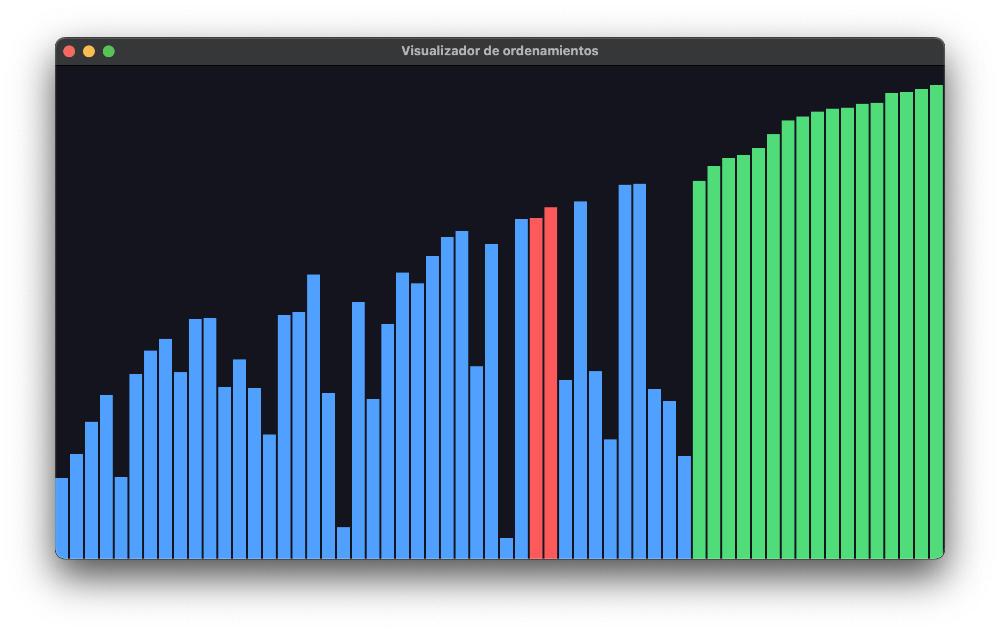

<div align="center">

# 📊 Visualizador de Ordenamientos

**Mira cómo "piensa" un algoritmo, comparación por comparación.**




</div>

---

## ✨ ¿Qué es esto?

Una aplicación de escritorio hecha **desde cero en C++** que anima un algoritmo de ordenamiento sobre un conjunto de barras. Cada barra representa un número: mientras más alta, mayor es su valor. El algoritmo avanza **un paso a la vez**, así que puedes ver exactamente qué compara, qué intercambia y qué ya quedó en su lugar final.

Nació como un proyecto de aprendizaje: salir de la terminal y construir algo que se vea, usando únicamente C++ y la librería gráfica [SFML](https://www.sfml-dev.org/).

## 🎮 Controles

| Tecla | Acción |
|:-----:|--------|
| `Espacio` | Iniciar / pausar el ordenamiento |
| `R` | Generar barras nuevas (aleatorias) |
| `↑` | Aumentar la velocidad |
| `↓` | Disminuir la velocidad |

## 🎨 Código de colores

| Color | Significado |
|:-----:|-------------|
| 🟦 Azul | Barra sin procesar |
| 🟥 Rojo | Par de barras que se está comparando |
| 🟩 Verde | Barra que ya quedó en su posición final |

## 🧠 Algoritmos

| Algoritmo | Estado |
|-----------|:------:|
| Bubble Sort | ✅ Implementado |
| Selection Sort | 🔜 Próximamente |
| Insertion Sort | 🔜 Próximamente |

## 🛠️ Cómo compilarlo

### Requisitos

- Un compilador de C++17 (Clang, GCC o MSVC)
- [CMake](https://cmake.org/) 3.16 o superior
- Git (CMake descarga SFML automáticamente, no necesitas instalarla a mano)

<details>
<summary><b>macOS</b></summary>

```bash
xcode-select --install     # Compilador (si aún no lo tienes)
brew install cmake         # CMake
```
</details>

<details>
<summary><b>Linux (Debian / Ubuntu)</b></summary>

SFML necesita algunas librerías del sistema para compilar:

```bash
sudo apt update
sudo apt install build-essential cmake git \
    libx11-dev libxrandr-dev libxcursor-dev libxi-dev \
    libudev-dev libgl1-mesa-dev libfreetype-dev
```
</details>

<details>
<summary><b>Windows</b></summary>

Instala [Visual Studio](https://visualstudio.microsoft.com/) con la carga de trabajo "Desarrollo para el escritorio con C++" (o MinGW), además de [CMake](https://cmake.org/download/) y Git.
</details>

### Compilar y ejecutar

```bash
git clone https://github.com/larabraham001/visualizador-ordenamientos.git
cd visualizador-ordenamientos

cmake -S . -B build
cmake --build build

./build/visualizador
```

> ⏳ **La primera compilación tarda unos minutos**, porque CMake descarga y compila SFML. Las siguientes son casi instantáneas.
>
> 🪟 En Windows el ejecutable puede quedar en `build/Debug/` o `build/Release/`.

## 📁 Estructura del proyecto

```
visualizador-ordenamientos/
├── CMakeLists.txt          # Configuración de compilación (descarga SFML)
├── include/
│   ├── BubbleSort.hpp      # Declaración de la clase BubbleSort
│   └── Utilidades.hpp      # Generación de valores aleatorios
├── src/
│   ├── main.cpp            # Ventana, ciclo principal y dibujo
│   ├── BubbleSort.cpp      # Implementación de Bubble Sort paso a paso
│   └── Utilidades.cpp
└── README.md
```

## 💡 ¿Cómo funciona?

El truco para animar un algoritmo es **no dejarlo correr de golpe**. Un bubble sort normal es un `for` dentro de otro `for` que termina en milisegundos, y solo verías el resultado final.

En este proyecto, las variables de los ciclos (`i` y `j`) se guardan **dentro de un objeto**. Cada llamada a `paso()` hace una sola comparación y devuelve el control al ciclo principal, que dibuja el cuadro actual. Así el algoritmo queda "en pausa" entre cuadro y cuadro.

```cpp
while (ventana.isOpen()) {
    // 1) Entrada: teclado y eventos de la ventana
    // 2) Actualización: burbuja.paso(valores);   ← una comparación
    // 3) Dibujo: una barra por cada valor del arreglo
}
```

Los datos (`std::vector<int>`) están separados de su representación visual: el algoritmo solo reordena el vector, y las barras se redibujan en cada cuadro.

## 🗺️ Próximos pasos

- [ ] Selection Sort e Insertion Sort
- [ ] Clase base `Algoritmo` (herencia y polimorfismo) para cambiar entre algoritmos con el teclado
- [ ] Texto en pantalla: nombre del algoritmo, comparaciones e intercambios
- [ ] Quick Sort y Merge Sort
- [ ] Visualizador de grafos (BFS, DFS, Dijkstra)

## 📚 Lo que se aprende con este proyecto

- Dividir un proyecto en `include/` y `src/`, con pares `.hpp` / `.cpp`
- Compilar con **CMake** y manejar dependencias externas con `FetchContent`
- El ciclo de un programa gráfico: entrada → actualización → dibujo
- Manejo de eventos y tiempo con SFML
- Cómo convertir un algoritmo clásico en una máquina de estados que avanza paso a paso

## 🙌 Créditos

Hecho por **Abraham Lara** como proyecto de aprendizaje en C++.
Gráficos con [SFML](https://www.sfml-dev.org/).